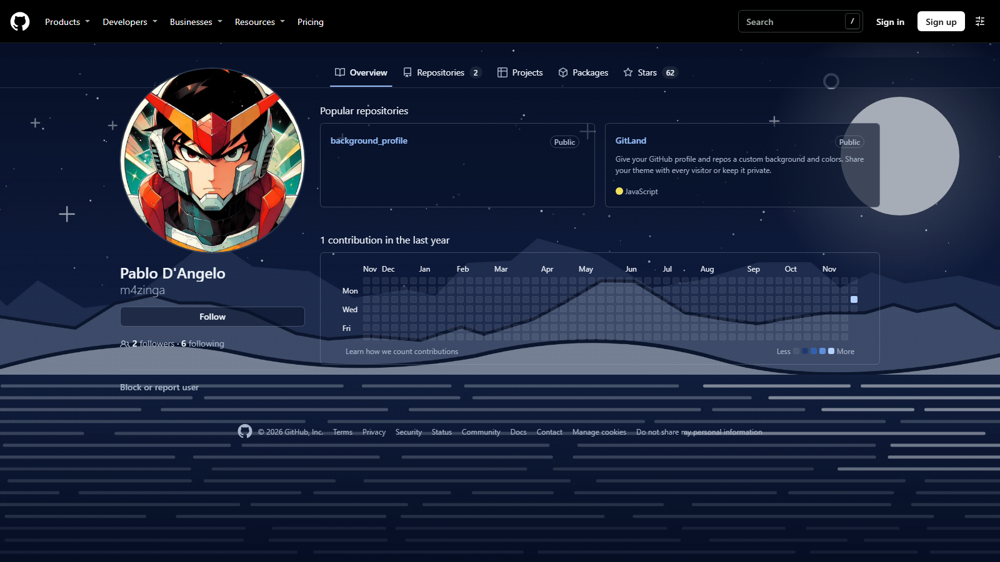
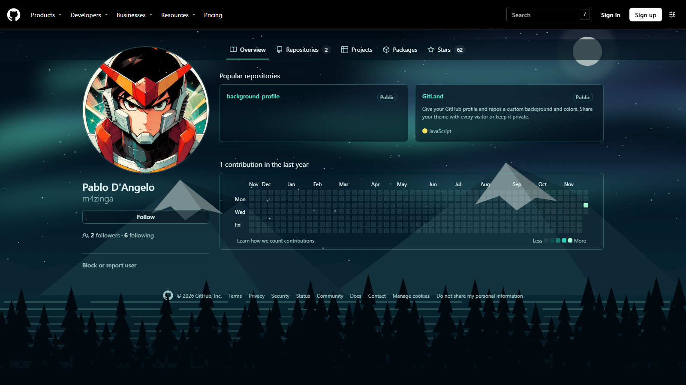
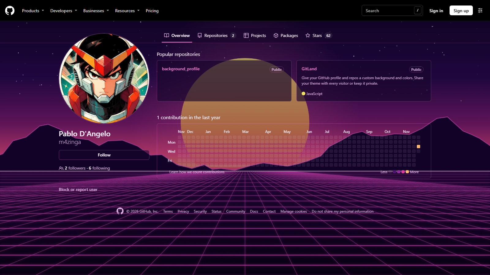
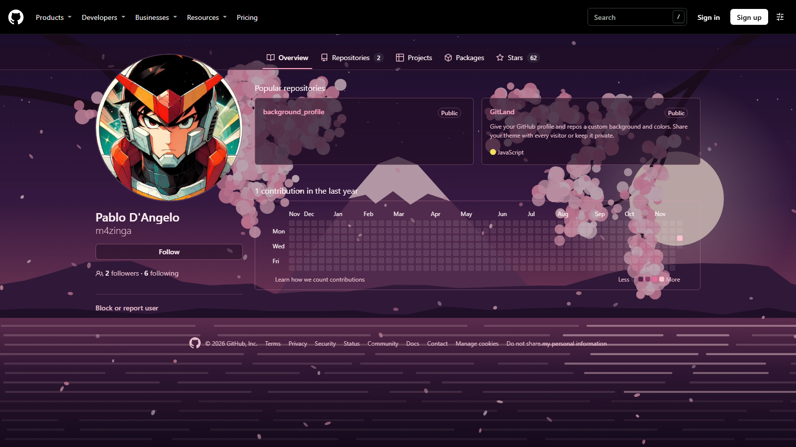
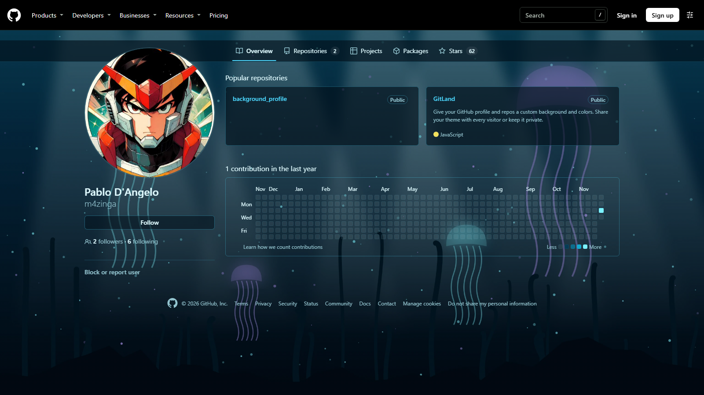
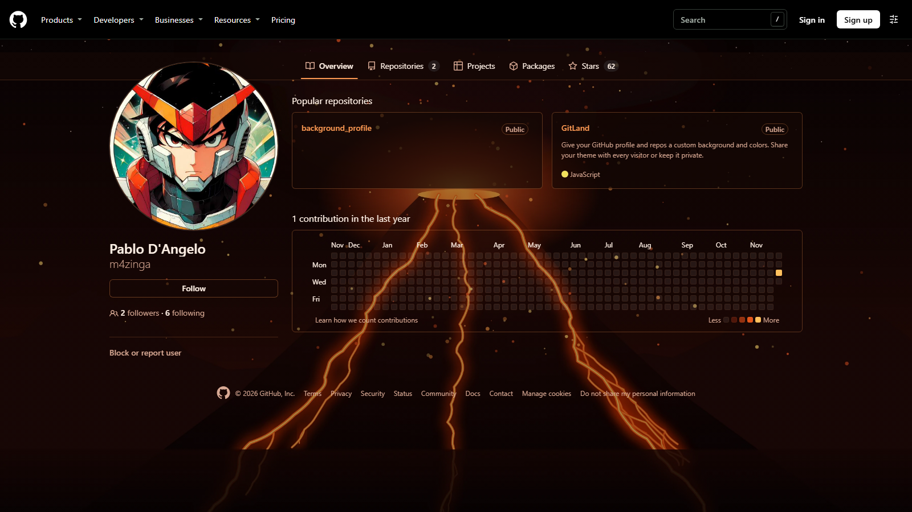

# GitLand themes

Ready-made themes for [GitLand](../README.md). Each one has an original wallpaper (2560×1440) and a
matching palette for GitHub's interface, including text, buttons and the contribution graph.

## Use a theme in 2 minutes

1. Install GitLand from the [Chrome Web Store](https://chromewebstore.google.com/detail/gitland/micckelifnonhoobagbmfbgkmhobcadc).
2. Create a repository named **`background_profile`** on your account. Make it **public** so visitors with GitLand
   see your theme, or **private** to keep it for yourself.
3. Add a `github_customization.json` file with the snippet of the theme you like (below).

You don't need to copy any image: the snippets point to the files hosted here.

To use a different theme on one of your repositories, add it under `"repo"` with the repository's name:

```json
{
  "profile": {
    "background_image": "https://github.com/m4zinga/GitLand/blob/main/themes/night/wallpaper.webp?raw=true",
    "style": "https://github.com/m4zinga/GitLand/blob/main/themes/night/style.json?raw=true"
  },
  "repo": {
    "my-project": {
      "background_image": "https://github.com/m4zinga/GitLand/blob/main/themes/synthwave/wallpaper.webp?raw=true",
      "style": "https://github.com/m4zinga/GitLand/blob/main/themes/synthwave/style.json?raw=true"
    }
  }
}
```

Want to tweak the colors? Open the GitLand popup on your profile, edit them live, then click
**Export style.json** and put the file in your `background_profile` repository.

---

## GitLand Night

The moonlit landscape of the GitLand logo.



```json
{
  "profile": {
    "background_image": "https://github.com/m4zinga/GitLand/blob/main/themes/night/wallpaper.webp?raw=true",
    "style": "https://github.com/m4zinga/GitLand/blob/main/themes/night/style.json?raw=true"
  }
}
```

## Aurora

Northern lights over a frozen pine forest.



```json
{
  "profile": {
    "background_image": "https://github.com/m4zinga/GitLand/blob/main/themes/aurora/wallpaper.webp?raw=true",
    "style": "https://github.com/m4zinga/GitLand/blob/main/themes/aurora/style.json?raw=true"
  }
}
```

## Synthwave

A striped retro sun setting over a neon grid.



```json
{
  "profile": {
    "background_image": "https://github.com/m4zinga/GitLand/blob/main/themes/synthwave/wallpaper.webp?raw=true",
    "style": "https://github.com/m4zinga/GitLand/blob/main/themes/synthwave/style.json?raw=true"
  }
}
```

## Sakura

Cherry blossoms at dusk over a quiet lake.



```json
{
  "profile": {
    "background_image": "https://github.com/m4zinga/GitLand/blob/main/themes/sakura/wallpaper.webp?raw=true",
    "style": "https://github.com/m4zinga/GitLand/blob/main/themes/sakura/style.json?raw=true"
  }
}
```

## Abyss

Bioluminescent jellyfish in the deep sea.



```json
{
  "profile": {
    "background_image": "https://github.com/m4zinga/GitLand/blob/main/themes/abyss/wallpaper.webp?raw=true",
    "style": "https://github.com/m4zinga/GitLand/blob/main/themes/abyss/style.json?raw=true"
  }
}
```

## Ember

A volcano glowing in the night.



```json
{
  "profile": {
    "background_image": "https://github.com/m4zinga/GitLand/blob/main/themes/ember/wallpaper.webp?raw=true",
    "style": "https://github.com/m4zinga/GitLand/blob/main/themes/ember/style.json?raw=true"
  }
}
```

---

## Make your own

The wallpapers are drawn in code, so they are easy to remix.

- [`source/scenes.js`](source/scenes.js): the wallpapers (SVG)
- [`source/themes.js`](source/themes.js): names and color palettes
- `node themes/source/build.js`: renders `wallpaper.webp` and writes `style.json` (needs Chrome or Edge)
- `node themes/source/preview.js`: renders `profile.png` on the real GitHub profile page

Themes and wallpapers are released under the same license as GitLand (CC0): use them however you like.
